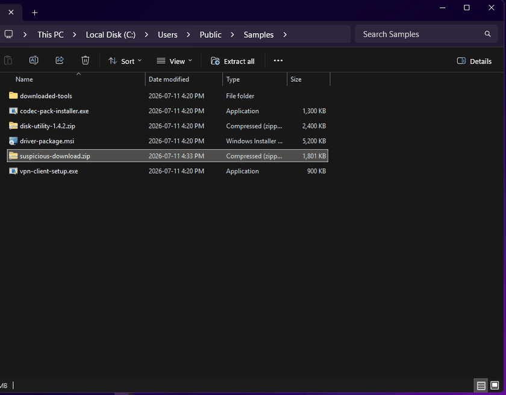
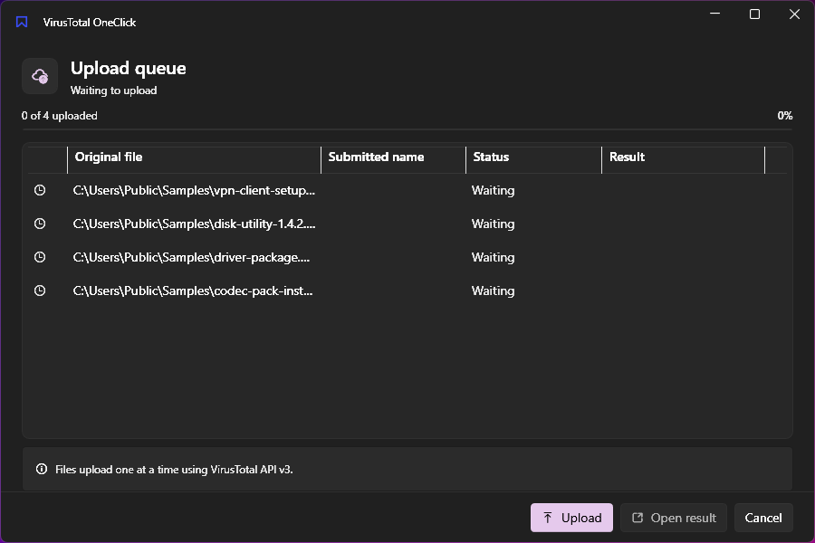
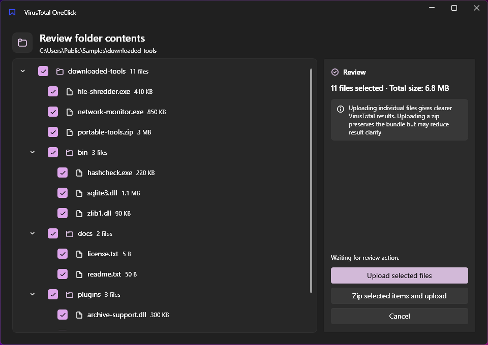
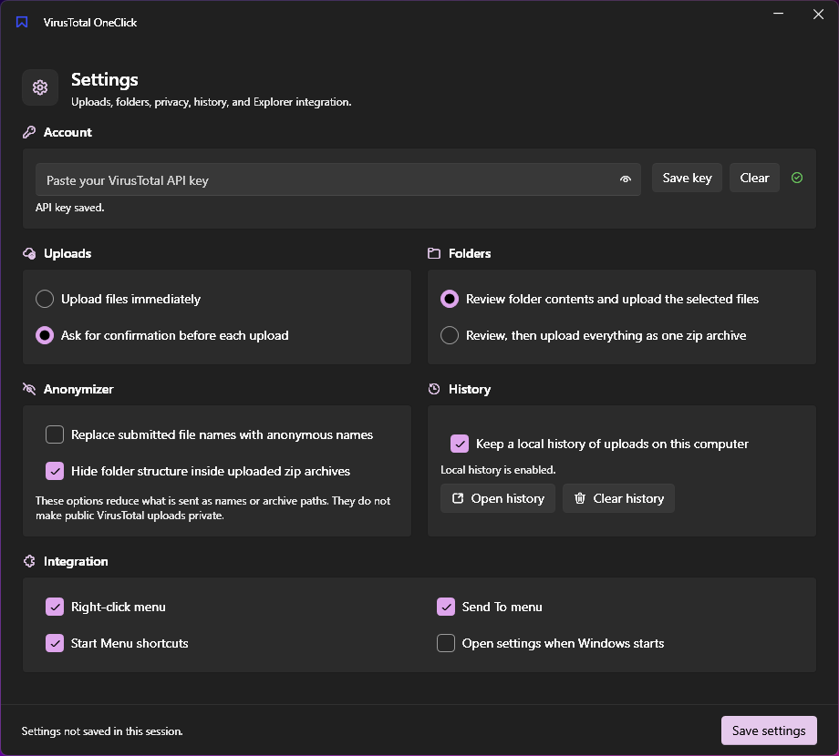
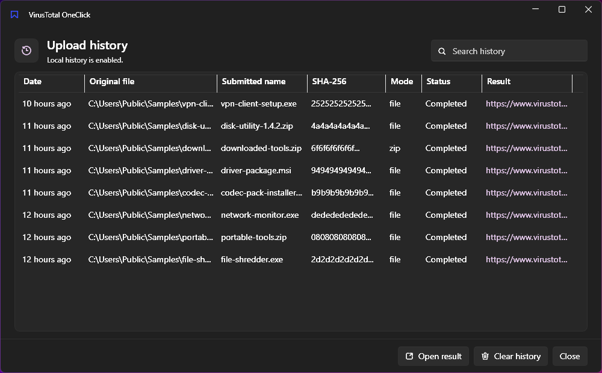

# VirusTotal OneClick

Right-click any file in Windows Explorer and scan it with VirusTotal.

[](https://github.com/ArteenHD/VirusTotalOneClick/releases/latest)
[](LICENSE)
[](https://github.com/ArteenHD/VirusTotalOneClick/actions/workflows/ci.yml)
[](https://github.com/ArteenHD/VirusTotalOneClick/releases)



| Upload queue | Folder review |
| --- | --- |
|  |  |

| Settings | History |
| --- | --- |
|  |  |

The app follows your Windows theme and accent color — every window works in light and dark mode.

## Install

1. Download **VirusTotalOneClickSetup.exe** from the [latest release](https://github.com/ArteenHD/VirusTotalOneClick/releases/latest).
2. Run it. The installer is per-user — no administrator rights needed. It adds the Explorer integration and opens the app so you can paste your API key and go.

> **SmartScreen warning:** releases are not yet code-signed, so Windows SmartScreen may warn on first run ("Windows protected your PC"). Click **More info → Run anyway**, or verify the download first — see below. Code signing is planned.

### Verify your download (optional but recommended)

Every release ships a SHA-256 checksum and a GitHub build-provenance attestation, so you can confirm the file you downloaded is exactly what the release workflow built:

```powershell
# Checksum: compare against VirusTotalOneClickSetup.exe.sha256 from the release
Get-FileHash .\VirusTotalOneClickSetup.exe -Algorithm SHA256

# Provenance: proves the file was built by this repo's release workflow on GitHub Actions
gh attestation verify .\VirusTotalOneClickSetup.exe --repo ArteenHD/VirusTotalOneClick
```

### Portable

Prefer no installer? Download **VirusTotalOneClick-win-x64.zip** from the release, extract it anywhere, and run:

```powershell
.\VirusTotalOneClick.exe install-shell    # add the Explorer integration
.\VirusTotalOneClick.exe uninstall-shell  # remove it again
```

The app is fully self-contained — no .NET runtime install required, and it runs nothing in the background: no services, no scheduled tasks, no startup processes (unless you turn on "Open settings when Windows starts" yourself).

## Usage

**1. Get a VirusTotal API key (free).** Sign up at [virustotal.com](https://www.virustotal.com/), then open your profile menu → **API Key** and copy it.

**2. Paste it into the setup window** that opens after install (or later in Settings). The key is validated against VirusTotal before it is saved.

**3. Right-click any file** in Explorer and choose **Upload to VirusTotal**. The upload queue opens, uploads the file, and gives you a link straight to the analysis report. Select several files at once and they merge into a single queue.

**Folders** never upload blindly: right-clicking a folder opens a review window showing everything inside, where you check exactly which files to send — individually or bundled as one zip archive.

Also available: **Send To → Upload to VirusTotal** for keyboard-friendly workflows, a **History** window of past uploads with report links, and **Settings** (in your Start Menu) for everything below.

### Options

- **Upload behavior** — upload immediately, or ask for confirmation first.
- **Folders** — upload reviewed files individually, or as a single zip.
- **Anonymizer** — replace submitted file names with anonymous ones, and hide folder structure inside uploaded zips. This reduces what metadata is sent; it does **not** make the upload private (see below).
- **History** — keep a local record of uploads, or turn it off entirely.
- **Integration** — toggle the right-click menu, Send To entry, Start Menu shortcuts, and launch-at-startup independently.

## Features

- One right-click from Explorer to a VirusTotal analysis report
- Multi-file selections coalesce into a single upload queue
- Folder review before anything is sent — pick files or zip the lot
- Handles files up to VirusTotal's 650 MB ceiling (large uploads route through VirusTotal's dedicated upload endpoint automatically)
- Sequential uploads with automatic retry when VirusTotal rate-limits
- Optional filename anonymization and zip path scrubbing
- Local, append-only upload history with one-click report access
- Native Windows 11 look: Mica backdrops, system accent, full light/dark support
- Per-user install, self-contained, nothing running in the background

## Security & Privacy

- **Your API key** is stored in `%APPDATA%\VirusTotalOneClick\apikey.bin`, encrypted with Windows DPAPI in current-user scope ([`DpapiFileSecretStore.cs`](src/VirusTotalOneClick.Core/DpapiFileSecretStore.cs)). Being honest about what that means: DPAPI protects the key at rest — against other users on the machine and against someone copying the file off your disk. It does **not** protect against malware already running as your user account; nothing purely software-based can.
- **Network traffic** goes exclusively to `https://www.virustotal.com/api/v3/` over HTTPS ([`VirusTotalClient.cs`](src/VirusTotalOneClick.Core/VirusTotalClient.cs)). Your key is sent only to VirusTotal, never anywhere else. There is no telemetry, analytics, or update phone-home.
- **Upload history** is a local JSONL file (`%APPDATA%\VirusTotalOneClick\history.jsonl`) that never leaves your machine. It is optional and clearable from Settings.
- The uninstaller asks whether to remove your saved settings, history, and API key.

### About the VirusTotal public API

This app uses VirusTotal's **free public API**, which is for non-commercial use and is limited to **4 requests per minute and 500 per day**. The app respects this by uploading sequentially and retrying when rate-limited.

More important: **files you upload become part of VirusTotal's shared corpus** and are available to security researchers and premium customers. This is public scanning, not a private malware check. Don't upload confidential documents, proprietary code, or anything containing personal data — the anonymizer options reduce the metadata sent, but the file content itself is always shared.

## FAQ

**Is this affiliated with VirusTotal?**
No. This is an independent open-source tool that talks to VirusTotal's public API. Not affiliated with, endorsed by, or sponsored by VirusTotal or Google.

**Is it safe to run?**
The full source is in this repository, releases are built by a public GitHub Actions workflow from tagged source, and every artifact ships with a checksum and a build-provenance attestation you can verify (see [Install](#install)). Don't take my word for it — read the code and verify the artifacts.

**Where is my API key stored, exactly?**
`%APPDATA%\VirusTotalOneClick\apikey.bin`, DPAPI-encrypted for your Windows account. Clearing the key in Settings deletes the file.

**Why does SmartScreen warn about the installer?**
Releases are currently unsigned — code-signing certificates are expensive for a free tool, and signing is planned. Until then, checksums and attestations are the verification story.

**Does it work on Windows 10?**
Windows 11 is the primary target. Windows 10 is best-effort: everything functions, and the newer window materials fall back gracefully to solid backgrounds.

## Scope and maintenance

This is a small, focused utility maintained by one person in spare time. Bug reports and PRs are welcome and I'll respond as time allows, but there is no SLA, and the scope stays deliberately narrow: right-click → VirusTotal, done well. See [CONTRIBUTING.md](CONTRIBUTING.md) if you'd like to help.

## License

[MIT](LICENSE) © ArteenHD

Not affiliated with, endorsed by, or sponsored by VirusTotal or Google. VirusTotal is a trademark of Google LLC. Requires your own VirusTotal API key.
